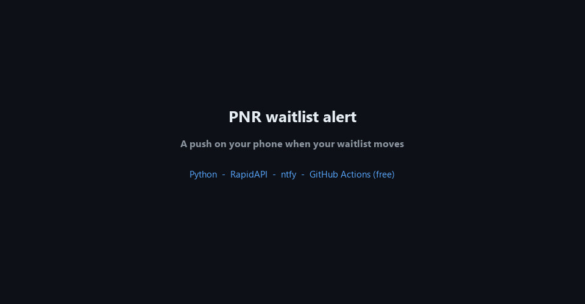
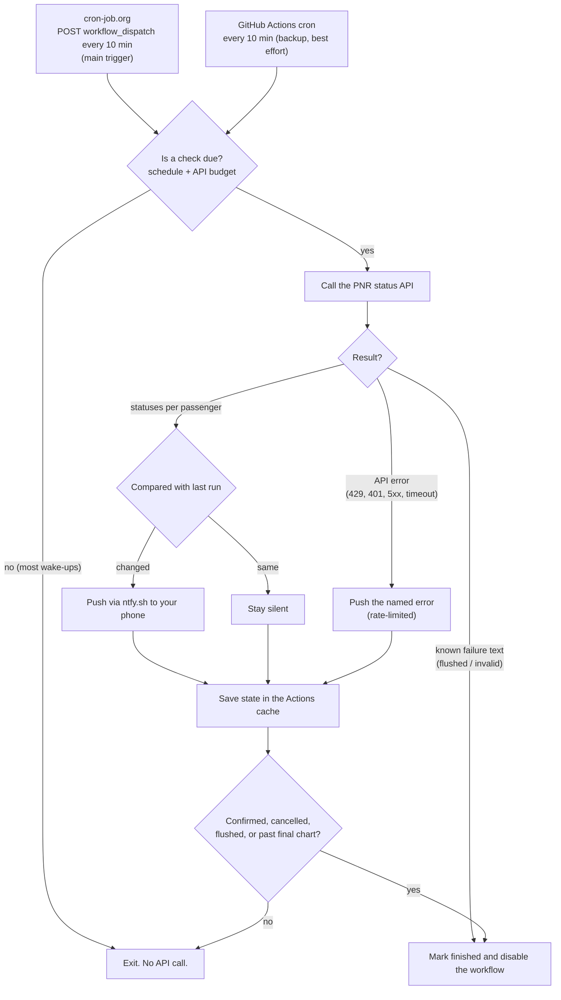

# PNR Waitlist Alert

Get a push notification on your phone when your Indian Railways **waitlist number drops**, you move to
**RAC**, or your ticket gets **confirmed**. It runs for free in the cloud (GitHub Actions), so your laptop
can be off, and it **stops by itself** once there is nothing left to watch.



*The demo shows a made-up journey, not a real PNR. Regenerate it with `python docs/make_demo_gif.py`
(needs `pip install pillow`).*

---

## Contents
1. [What it does](#what-it-does)
2. [How it works](#how-it-works)
3. [Polling schedule and the free quota](#polling-schedule-and-the-free-quota)
4. [Scenarios: what happens when...](#scenarios-what-happens-when)
5. [Tech stack](#tech-stack)
6. [Project layout](#project-layout)
7. [Setup](#setup)
8. [Configuration reference](#configuration-reference)
9. [Command reference](#command-reference)
10. [Testing](#testing)
11. [Security and privacy](#security-and-privacy)
12. [Limitations](#limitations)
13. [Troubleshooting](#troubleshooting)
14. [Reliable scheduling with cron-job.org](#reliable-scheduling-with-cron-joborg)

---

## What it does

- Checks your PNR on a schedule and compares it with the last status it saw.
- Sends a phone push (via [ntfy](https://ntfy.sh)) **only when something changes**. No change means silence.
- Checks rarely when the journey is far away and **every 10 minutes during the two chart preparations**
  (about 4 h and 2 h before departure), when waitlists move the most.
- Never exceeds the free API plan: it has a monthly call budget with calls held back for the chart windows.
- Tells you when something is wrong (quota reached, bad key, API down) and names the specific error.
- Stops polling when the ticket is confirmed, cancelled, flushed, or the final chart window has passed, and
  disables its own scheduled workflow.

## How it works



The important idea: **waking up is free, calling the API is not.** The job wakes every 10 minutes, but the
script looks at the clock and only calls the API when the schedule says a check is due. That is how a
100-calls-a-month free plan can still give you 10-minute checks when it matters.

State (last status, last check time, API calls used, failure streak, finished flag) lives in `state.json`,
which the workflow keeps between runs using the GitHub Actions cache.

## Polling schedule and the free quota

How often the API is called, by time left before departure (cloud settings: `BASE_POLL_MINUTES=60`,
`CHART_POLL_MINUTES=10`):

| Time before departure | API call every | Phase name |
|---|---|---|
| more than 4 h | **60 min** (hourly) | far / week / 2-days / day-of / pre-chart |
| 2 h to 4 h (first chart) | **10 min** | `chart1` |
| 30 min to 2 h (second chart) | **10 min** | `chart2` |
| under 30 min | stops (status is frozen after the final chart) | `done` |

Without `BASE_POLL_MINUTES` the early phases are slower (24 h, 12 h, 6 h, 3 h, 1 h), which suits a ticket
booked weeks ahead. See the planned number of calls for your own trip any time with `--plan`.

**Quota safety**

| Guard | Value | Meaning |
|---|---|---|
| Plan limit (RapidAPI free "Basic") | 100 calls / month, hard | the provider refuses calls after this |
| `MONTHLY_BUDGET` | 85 in the workflow | the script stops itself well below the limit |
| `CHART_RESERVE` | 15 | early polling may use at most 70; the last 15 are kept for the chart windows |
| Typical trip (2 days, hourly) | about 70 calls | fits with room to spare |

When the budget is reached you get one "API quota used up" push and the script skips calls until next month.

## Scenarios: what happens when...

| Situation | What the script does | Phone push |
|---|---|---|
| First ever check | Records the status | "Tracking started: WL 35" |
| Nothing changed | Saves the time of the check | none |
| Waitlist number drops (WL 35 to WL 28) | Records the new number | "Waitlist dropped! WL 35 -> WL 28" |
| Waitlist number goes up | Records it | "Waitlist went up" |
| WL moves to RAC | Records it | "Moved to RAC!" |
| All passengers confirmed | Marks finished, disables the workflow | "PNR CONFIRMED!" |
| Some passengers confirmed, others still waiting | Keeps polling, tracks each passenger | "P2: WL 10 -> WL 8" style |
| Status says cancelled / flushed / regret | Marks finished, disables the workflow | "Ticket cancelled/flushed" |
| API says `FLUSHED PNR` | Marks finished, disables the workflow | "PNR flushed" |
| API says `Invalid PNR Number` | Stops (retrying would waste quota) | "Invalid PNR" |
| API says `PNR NOT YET GENERATED` | Keeps polling on schedule | none |
| API error: quota or rate limit (HTTP 429) | Counts the failure, keeps going | "PNR alert problem: API limit reached (HTTP 429)..." |
| API error: bad key (401/403), wrong URL (404), server error (5xx), timeout, network | Same | A push that names the error |
| Failure repeats | Pushes on the 1st and every 6th failure in a row, not every 10 min | as above |
| A check works again after failures | Clears the failure count | "PNR checks working again" |
| Monthly budget reached | Skips calls | "API quota used up" (once) |
| 30 minutes before departure | Stops, disables the workflow | "Polling finished" |
| GitHub runs the cron a few minutes late | 3-minute grace so a slot is not skipped | none |
| Cache lost (unused for 7 days) | Starts again from "first check" | "Tracking started" again |

## Tech stack

| Layer | Choice | Why |
|---|---|---|
| Language | **Python 3.12** (runs on 3.10+) | one small script, no framework |
| HTTP | `requests` | calling the PNR API and ntfy |
| PNR data | **RapidAPI** IRCTC / PNR status API (free "Basic" plan) | there is no official public API and IRCTC has captchas; any provider whose JSON has a `currentStatus` field works |
| Phone push | **[ntfy.sh](https://ntfy.sh)** | free, no account, one HTTP POST |
| Hosting | **GitHub Actions** (private repo) | free, runs while your laptop is off |
| Scheduler | **[cron-job.org](https://cron-job.org)** calling `workflow_dispatch` every 10 min, plus GitHub cron `*/10 * * * *` as backup | GitHub's own cron did not fire reliably (see [below](#reliable-scheduling-with-cron-joborg)) |
| State between runs | `actions/cache` + `state.json` | free, no database |
| Secrets | GitHub Actions Secrets | key, PNR, topic never in the code |
| Self-shutdown | `gh workflow disable` from the job | stops runs when the ticket is resolved |
| Tests | `pytest` (28 tests) | schedule, budget, parsing, failure handling |
| Demo | Pillow (dev only) | generates `docs/demo.gif` |

## Project layout

```
pnr-alert/
├── pnr_alert.py                    # the whole app (fetch, compare, schedule, notify, budget)
├── .github/workflows/pnr-alert.yml # cloud cron job + self-disable step
├── .env.example                    # settings template (copy to .env for local runs)
├── requirements.txt                # requests, pytest
├── test_pnr_alert.py               # parsing, comparison, schedule, budget, stop rules
├── test_failures.py                # named failure pushes, rate limit, recovery
├── test_base_poll.py               # hourly mode and quota maths
├── test_env_bom.py                 # Windows BOM handling for .env and secrets
└── docs/
    ├── demo.gif                    # animated demo shown above
    └── make_demo_gif.py            # regenerates the GIF
```

## Setup

### 1. Phone
1. Install the **ntfy** app (Play Store or App Store).
2. Pick a long, hard-to-guess topic name, for example `myname-pnr-8f3k29x1`, and **subscribe** to it in the app.
3. Allow notifications. On Android also turn off battery optimization for the app so alerts are not delayed.

> The topic name is the only thing protecting your alerts. Anyone who knows it can read them.

### 2. PNR API key
1. Create a free account at [rapidapi.com](https://rapidapi.com) and subscribe to a PNR status API on its free plan.
2. On its **Endpoints** tab, run the PNR endpoint and open the code snippet. You need three things from it:
   the **URL**, the `X-RapidAPI-Key` and the `X-RapidAPI-Host` values.
3. Replace your PNR in the URL with `{pnr}`, for example
   `https://<host>/getPNRStatus/{pnr}`.

Check the plan's call limit before you rely on it. The free plan used while building this allowed **100
calls per month**, and the numbers in this README assume that.

### 3. Local run (optional but recommended for a first test)

```powershell
git clone <your repo url>; cd pnr-alert
python -m venv .venv; .\.venv\Scripts\activate
pip install -r requirements.txt
copy .env.example .env        # then edit .env (see the configuration reference)
```

Try it in this order. The first three make no API call:

```powershell
python pnr_alert.py --demo          # simulate a waitlist dropping (console only)
python pnr_alert.py --test-notify   # your phone should buzz
python pnr_alert.py --plan          # shows the schedule and how many calls it will use
python pnr_alert.py --once --force  # ONE real API call; should push "Tracking started: WL nn"
```

Saving `.env`: use a plain editor or UTF-8 without BOM. The script now tolerates a BOM, but other tools may not.

### 4. Cloud run (free, laptop can be off)

1. Install and log in to the [GitHub CLI](https://cli.github.com): `winget install --id GitHub.cli`,
   open a **new** terminal, then `gh auth login`.
2. Create a **private** repo and push:
   ```powershell
   git init -b main; git add -A; git commit -m "PNR alert"
   gh repo create pnr-alert --private --source . --push
   ```
   `.env` and `state.json` are in `.gitignore`, so they are not uploaded.
3. Add the five secrets. The safest way is the website: **Repo, Settings, Secrets and variables, Actions,
   New repository secret**. Names and values:

   | Secret | Value |
   |---|---|
   | `PNR` | your 10-digit PNR |
   | `DEPARTURE` | departure from your boarding station, India time, e.g. `2026-11-20 18:30` |
   | `NTFY_TOPIC` | your topic name |
   | `PNR_API_URL` | the URL with `{pnr}` in it |
   | `PNR_API_HEADERS` | `{"X-RapidAPI-Key": "...", "X-RapidAPI-Host": "..."}` |

   With the CLI, in **bash** use `gh secret set NAME --body "value"`. In Windows PowerShell 5.1, piping text
   to `gh` can prepend a hidden BOM character, so set `$OutputEncoding = New-Object System.Text.UTF8Encoding $false`
   first or use the website.
4. Run it once by hand: **Actions tab, pnr-alert, Run workflow** (or `gh workflow run pnr-alert.yml`). A green
   run with "Tracking started" on your phone means it works.
5. **Set up the external trigger** described in
   [Reliable scheduling with cron-job.org](#reliable-scheduling-with-cron-joborg). Do not rely on GitHub's
   own cron alone: in practice it did not fire at all for hours.

### 5. Stopping and cleaning up
- It disables itself when the ticket is confirmed or cancelled, the PNR is flushed, or the final chart is past.
- To stop sooner: `gh workflow disable pnr-alert.yml`.
- After your trip: delete the repo and the RapidAPI subscription, and unsubscribe from the ntfy topic.

## Configuration reference

Local runs read `.env`. In the cloud the same names come from the workflow file (`env:`) and Secrets.

| Variable | Required | Default | What it does |
|---|---|---|---|
| `PNR` | yes | | your 10-digit PNR |
| `DEPARTURE` | yes (for the schedule) | | `YYYY-MM-DD HH:MM`, departure from your boarding station, India time |
| `NTFY_TOPIC` | yes | | where pushes go; without it alerts only print to the console |
| `PNR_API_URL` | yes | | API URL; `{pnr}` is replaced with your PNR |
| `PNR_API_HEADERS` | yes | `{}` | JSON of request headers (the RapidAPI key and host) |
| `NTFY_SERVER` | no | `https://ntfy.sh` | use your own ntfy server |
| `BASE_POLL_MINUTES` | no | off | cap early polling at this many minutes (cloud uses `60`) |
| `CHART_POLL_MINUTES` | no | 20 / 15 | polling interval in the two chart windows (cloud uses `10`) |
| `MONTHLY_BUDGET` | no | 90 | stop calling the API after this many calls in a month (cloud uses `85`) |
| `CHART_RESERVE` | no | 15 | calls held back for the chart windows |
| `CHECK_TICK_MINUTES` | no | 5 | how often `--loop` wakes up locally (free) |
| `TZ_OFFSET_MINUTES` | no | 330 | timezone of `DEPARTURE` as minutes from UTC (330 = India); the cloud runs in UTC |

## Command reference

| Command | What it does |
|---|---|
| `python pnr_alert.py --once` | one scheduled pass: calls the API only if a check is due. Exit code `3` means "nothing left to watch" |
| `python pnr_alert.py --once --force` | call the API now, ignoring the schedule |
| `python pnr_alert.py --loop` | keep running on your machine, waking every `CHECK_TICK_MINUTES` |
| `python pnr_alert.py --plan` | print the planned calls per phase and the total (no API calls) |
| `python pnr_alert.py --test-notify` | send a test push |
| `python pnr_alert.py --demo` | simulate WL 23, 17, 9, RAC, CNF in a sandbox (never touches your real state or phone) |

## Testing

```powershell
pip install pytest
python -m pytest -q        # 28 tests, none of them call the real API
```

The tests cover status parsing, change detection, the polling schedule, hourly mode, the quota budget and
chart reserve, the stop rules (confirmed, cancelled, flushed, past cutoff), the named failure pushes and
their rate limit, and BOM handling.

## Security and privacy

- Secrets live in GitHub Secrets or your local `.env`, which is git-ignored. Do not commit them.
- Use a **private** repo. The script masks your PNR in its log output (for example `12******90`) and GitHub masks secret
  values in logs, but keeping the repo private is the real protection.
- Your PNR is sent to the API provider you choose. Pick one you are comfortable sharing ticket details with.
- ntfy.sh topics are public by name. A long random topic is a password. Anyone who learns it can read your alerts.
- Passenger names are never printed or stored by this tool.

## Limitations

- **Not instant.** Between chart windows it checks hourly, so a drop can be noticed up to about an hour
  late. More often needs a bigger API quota or a paid plan.
- **Unofficial data.** It relies on a third-party API, not IRCTC. If the provider changes its response or
  goes down, you will get a named failure push, but checks will fail until it is fixed. The script reads the
  per-passenger `currentStatusDetails` field (falling back to `currentStatus`); a provider that names it
  differently needs a small change in `find_current_statuses()`.
- **GitHub cron is best effort.** Scheduled runs can be delayed by hours or skipped entirely, which is why
  cron-job.org is the main trigger. The script tolerates a few minutes of lateness from either trigger.
- **cron-job.org is a third party.** It holds a GitHub token limited to this one repo's Actions. If the
  service is down, the GitHub cron is the only (unreliable) backup.
- **One PNR per deployment.** Track a second ticket with a second repo or by extending the script.
- **Waitlists move because of cancellations and charts.** The tool cannot make the number drop faster.
- **How cancellations are reported depends on the API.** It handles `CAN`, `FLUSH` and `REGRET` statuses
  and the `FLUSHED PNR` message. If your provider signals cancellation differently, polling still ends 30
  minutes before departure.
- **Windows tip:** `.env` saved with a BOM or secrets piped from PowerShell 5.1 can carry a hidden character.
  The loader strips it, but you may meet it in other tools.

## Troubleshooting

| Symptom | Likely cause and fix |
|---|---|
| Push says `API limit reached (HTTP 429)` | the provider's quota is used up; wait for the monthly reset or upgrade the plan |
| `API key rejected (HTTP 401)` or `access denied (HTTP 403)` | wrong or expired key, or not subscribed to the plan |
| `API endpoint not found (HTTP 404)` | wrong path in `PNR_API_URL`; copy the URL from the provider's code snippet |
| `Invalid PNR` push | typo in `PNR`, or the secret has extra characters; re-enter it |
| No phone push at all | topic name differs between the app and `NTFY_TOPIC`; run `--test-notify`; check notification and battery settings |
| `--once` prints nothing | normal: no check was due. Use `--once --force` to call now |
| Workflow never runs by itself | GitHub's cron is unreliable; set up [cron-job.org](#reliable-scheduling-with-cron-joborg). Also check the workflow is not disabled |
| cron-job.org shows 404 | method left as GET, `Authorization` header missing or wrong, or the token lacks access to this repo. Opening the URL in a browser always gives 404 (it is POST-only) |
| cron-job.org shows 401 | token mistyped, expired, or `Bearer ` prefix missing |
| cron-job.org shows 422 | the workflow is disabled (normal once the ticket is resolved); delete the cron job |
| "Tracking started" again later | the cache expired or was cleared, so the baseline was lost; harmless |
| Workflow shows red | open the run log; failures that reach the job (as opposed to API errors, which push) are usually a setup issue |
| `PNR_API_URL is not set` / `PNR is not set` | `.env` missing or unreadable locally; or a Secret is missing in the cloud |
| Wrong times in the cloud | check `TZ_OFFSET_MINUTES` and that `DEPARTURE` is in India time |

## Reliable scheduling with cron-job.org

### What went wrong

On 5 Nov 2026 the PNR was at **WL 35** after the last manual run (11:37 UTC / 17:07 IST). The waitlist
then dropped, but **no notification arrived**. Investigation showed:

| Checked | Finding |
|---|---|
| Actions run history | only 5 runs, **all manual** (`workflow_dispatch`). **Zero** runs with event `schedule` in about 4 hours |
| Workflow file | correct: `cron: "*/10 * * * *"` present, pushed to `main`, workflow state `active` |
| Script logic | correct: `compare()` sends "Waitlist dropped!" for any drop; manual runs all worked |
| IST handling | correct: at 15:30 UTC the script's clock read 21:00 IST (`TZ_OFFSET_MINUTES=330`), and `DEPARTURE` is read as IST |

So **nothing was missing or broken in our code.** No check ran during those hours, so there was nothing to
notice the drop. A drop is only reported when a check actually runs.

### Why GitHub's cron didn't fire

GitHub treats `on: schedule` as **best effort**. Scheduled runs are queued behind other jobs, can be delayed
by an hour or more, can be **skipped entirely** (frequent crons like every 10 minutes are the most likely to
be dropped), and new workflows can wait a long time before their first scheduled run. We can't see GitHub's
side, so this is the most likely explanation rather than a confirmed one, but the effect is clear: GitHub's
cron cannot be trusted for something time-sensitive like chart-window polling.

### What we changed

**The code and workflow did not change.** Only the thing that *starts* the workflow changed:

| | Before | Now |
|---|---|---|
| Trigger | GitHub's own scheduler (`on: schedule`) | **cron-job.org** calls GitHub's API (`workflow_dispatch`) every 10 min |
| Reliability | did not fire for 4+ hours | same mechanism as the manual runs, which worked every time |
| Laptop needed? | no | no |
| GitHub cron | main trigger | kept as a backup |

Both triggers can run safely side by side: the script's "is a check due?" logic (last check time, schedule,
budget) decides whether to call the API, so extra wake-ups cost **no API quota** and never double-poll.

### Setup, step by step

**Part 1: create a GitHub token**

1. GitHub, **profile picture** (top right), **Settings**.
2. Left sidebar, very bottom: **Developer settings**.
3. **Personal access tokens**, **Fine-grained tokens**, **Generate new token**.
4. Fill in:
   - **Token name:** `pnr-alert-cron`
   - **Expiration:** custom, a day after your trip.
   - **Repository access:** **Only select repositories**, pick **pnr-alert**.
   - **Permissions**, **Repository permissions**, **Actions:** **Read and write**. Leave everything else.
5. **Generate token** and copy it (starts with `github_pat_`). GitHub shows it only once.

**Part 2: create the job on cron-job.org**

1. Sign up (free) at [cron-job.org](https://cron-job.org) and confirm your email.
2. Account name (top right), **Account settings**, **Timezone:** **Asia/Kolkata**. Save.
3. **Cronjobs**, **Create cronjob**.
4. **Common** tab:
   - **Title:** `pnr-alert`
   - **URL:** `https://api.github.com/repos/shr-coditas/pnr-alert/actions/workflows/pnr-alert.yml/dispatches`
   - **Execution schedule:** every 10 minutes.
   - Turn on **Notify me when the execution of the cronjob fails**.
5. **Advanced** tab:
   - **Request method:** **POST** (the default is GET, which gives 404).
   - **Headers:**

     | Key | Value |
     |---|---|
     | `Authorization` | `Bearer github_pat_xxxx` (your token after `Bearer `) |
     | `Accept` | `application/vnd.github+json` |
     | `Content-Type` | `application/json` |

   - **Request body:** `{"ref":"main"}`
6. **Create** / **Save**.

**Part 3: test**

1. Open the job and click **Test run**. **`204 No Content`** means success. For 404 / 401 / 422 see
   [Troubleshooting](#troubleshooting).
2. On GitHub, **Actions** tab: a new `workflow_dispatch` run should appear within seconds.

Optional command-line test (Git Bash). This triggers a real run:

```bash
curl -i -X POST \
  -H "Authorization: Bearer YOUR_TOKEN" \
  -H "Accept: application/vnd.github+json" \
  -d '{"ref":"main"}' \
  https://api.github.com/repos/shr-coditas/pnr-alert/actions/workflows/pnr-alert.yml/dispatches
```

> **Note:** the URL is a POST-only API endpoint. Opening it in a browser always shows "Not Found"; that is
> expected and does not mean the URL is wrong.

### After the trip

When the ticket is confirmed or cancelled, or the chart window is over, the workflow disables itself and
cron-job.org starts reporting failures (HTTP 422). That is the signal to **delete the cron job** and
**delete the GitHub token** (Settings, Developer settings, Fine-grained tokens).
